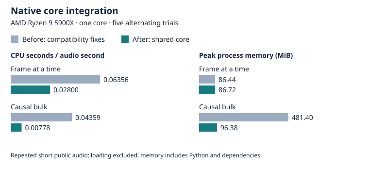

Native online beat core
=======================

The existing Python processors and the standalone C engine share C++ kernels, including a hidden Markov model (HMM) forward decoder. This removes duplicate numerical implementations and bounds online decoder memory. Public processor names, model files, constructor arguments, and frame-origin defaults remain available.

Build and use
-------------

A source build requires C and C++17 compilers plus Python headers::

    git submodule update --init madmom/models
    python -m pip install .

Use the existing Python API::

    from madmom.features.beats import RNNBeatProcessor, DBNBeatTrackingProcessor
    activations = RNNBeatProcessor(online=True, origin='online')('audio.wav')
    beats = DBNBeatTrackingProcessor(online=True, fps=100)(activations)

``online=True`` selects online models. ``origin='online'`` selects causal bulk frames; ``origin='stream', num_frames=1`` accepts streaming frames. The default origin remains unchanged. The `C interface and build example <../native/README.md>`_ describe standalone use.

Compatibility
-------------

.. list-table:: Shared implementation and limits
   :header-rows: 1

   * - Component
     - Native support
     - Compatibility behavior
   * - Frontend
     - 2048 samples, 81 bands, int16 or float32 PCM
     - Python retains framing, resampling, filterbanks, and mutable settings
   * - Neural inference
     - Float32 dense, recurrent, and LSTM layers
     - Model edits, state references, reset, and pickle behavior remain supported
   * - Forward HMM
     - Double-precision recursion
     - ``forward`` returns all rows; additive ``forward_states`` retains one posterior row
   * - Peak and beat events
     - Existing thresholds and equal-maximum rules
     - Existing event times remain covered by release fixtures
   * - Other configurations
     - Existing Python, NumPy, SciPy, or Cython implementation
     - Unsupported dtypes, custom functions, and modified chains remain usable

Single-frame neural output retains the time axis used by madmom 0.16.1: ``(1,)`` for one output or ``(1, N)`` for multiple outputs. This fixes the scalar or squeezed output in the development baseline. Callers that relied on the development shape must account for this correction.

The native extension is required, as are the existing Cython extensions. Installation fails if compilation fails. SSE2 and AArch64 NEON vectorize independent calculations; other targets use scalar arithmetic. Compiler settings disable fused multiply-add contraction to limit numerical differences. FFT tables add 16 KiB per frontend instance.

The C engine accepts finite mono float32 PCM at 44100 Hz. Its raw maximum posterior is a tracker reliability signal, not a music-presence probability. It does not include capture, resampling, clocks for external consumers, or delivery transports.

Measured processing cost
------------------------

The baseline contains the compatibility fixes at ``d3e30b5``. The candidate adds shared native kernels at ``bf438cd``. Both use the same models, public test audio, and dependencies. The `compact data <benchmarks/native-summary.json>`_ retain each CPU trial, maximum process memory, source revisions, and loaded extension hashes.

.. list-table:: Complete Python online path, AMD Ryzen 9 5900X
   :header-rows: 1

   * - Path
     - Before CPU s / audio s
     - After CPU s / audio s
     - Before / after peak MiB

   * - Frame at a time
     - 0.063559
     - 0.028000
     - 86.44 / 86.72

   * - Causal bulk
     - 0.043590
     - 0.007780
     - 481.40 / 96.38

Five alternating trials use fresh processes, Python 3.12.13, NumPy 2.4.6, SciPy 1.18.1, one pinned core, one BLAS/OpenMP thread, and 68.507 seconds of repeated public test audio. Loading and initialization are excluded. Peak resident memory includes Python and dependencies. CPU frequency and other host activity were uncontrolled. The short recordings establish compatibility; they do not establish corpus accuracy, callback deadlines, or physical ARM performance.

The one-row forward decoder removes the frame-by-state posterior array from online beat processing. This explains the bulk memory reduction. Streaming already processes one frame at a time, so its peak memory changes little.

Compare independently built packages with the included tool::

    OPENBLAS_NUM_THREADS=1 OMP_NUM_THREADS=1 MKL_NUM_THREADS=1 \
      python tools/benchmark_core.py --reference-root reference-checkout \
      --package-root candidate-checkout --reference-revision BASE_COMMIT \
      --paired --repeats 5 --copies 10 --stages bulk stream \
      --output benchmark.json

Recreate the small chart from the compact recorded data::

    python tools/plot_native_benchmarks.py

Verification and provenance
---------------------------

The installed wheel passed 1,055 tests and 68 subtests on Python 3.11, 3.12, and 3.13 with NumPy 2. Python 3.12 also passed all 46 module doctests. CMake Release, the standalone C API test, and the strict C11 example compile/link/run passed on Linux x86-64.

Run ``python -m pytest tests`` and the independent C API checks in `native/README.md <../native/README.md>`_. `Release fixtures <native-reference.rst>`_ cover 687 frames from unmodified madmom 0.16.1, including frontend features, individual networks, forward posteriors, event times, reset, and chunk boundaries. `Linux wheels <native-wheels.rst>`_ document glibc and architecture checks.

Reference algorithms are by Sebastian Böck and the madmom contributors: `madmom 0.16.1 <https://github.com/CPJKU/madmom/tree/6545fbb3ecdae0aac336a95ec591f642e0b74f3e>`_ at ``6545fbb3ecdae0aac336a95ec591f642e0b74f3e`` and `inherited development source <https://github.com/CPJKU/madmom/tree/27f032e8947204902c675e5e341a3faf5dc86dae>`_ at ``27f032e8947204902c675e5e341a3faf5dc86dae``. The kernels, FFT, adapters, and C interface are original project work. Existing code and model licences remain intact.
